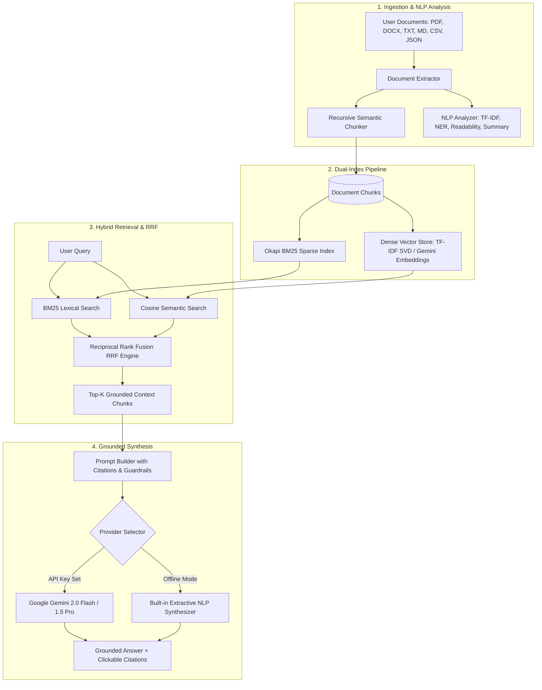

# RAGNova: NLP-Powered RAG Document Assistant & Intelligence Suite

<div align="center">

[](https://python.org)
[](https://flask.palletsprojects.com/)
[](https://scikit-learn.org/)
[](https://ai.google.dev/)
[](https://github.com/bhanukousik127-gif/NLP-powered-RAG-document-assistant/actions)
[](https://opensource.org/licenses/MIT)

**A high-performance, evidence-grounded Retrieval-Augmented Generation (RAG) assistant combining Okapi BM25 lexical keyword matching, Dense Vector Semantic Embeddings, Reciprocal Rank Fusion (RRF), and NLP document intelligence.**

[Key Features](#key-features) • [Architecture](#architecture) • [Quickstart](#quickstart) • [NLP Suite](#nlp-suite) • [API Reference](#api-reference) • [RAG Tuning](#rag-tuning)

</div>

---

## 🌟 Key Features

- **⚡ Hybrid Multi-Index Retrieval**: Fuses **Okapi BM25** sparse keyword scoring and **Dense Vector semantic cosine similarities** using **Reciprocal Rank Fusion (RRF)**:
  $$\text{RRF Score}(d) = \alpha \cdot \frac{1}{60 + \text{rank}_{\text{BM25}}(d)} + (1 - \alpha) \cdot \frac{1}{60 + \text{rank}_{\text{Vector}}(d)}$$
  *(Adjustable balance slider $\alpha \in [0.0, 1.0]$ in settings).*
- **🛡️ Evidence Grounding & Exact Citations**: Every generated response includes verified source attribution chips (e.g., `[DocName, Page X, Chunk ID]`). Clicking a chip opens the **Evidence Attribution Drawer** displaying the exact excerpt, similarity score, and retrieval consensus type.
- **🚫 Anti-Hallucination Guardrails**: Detects low context-relevance scores and prevents hallucinated responses when evidence is not present in the document collection.
- **📊 Deep Document NLP Intelligence**:
  - **TF-IDF Keyphrase Discovery**: Extracts statistically salient unigrams and bigrams.
  - **Named Entity Recognition (NER)**: Identifies technical concepts, metrics/quantities, dates/years, and organizations.
  - **Flesch Readability Index**: Computes Flesch Reading Ease and grade-level complexity.
  - **Extractive Executive Summary**: Generates concise TextRank-style summaries.
- **🔌 Multi-Model Flexibility**:
  - **100% Offline Mode**: Runs completely locally with zero external API keys using built-in semantic vectorizers and local NLP answer synthesizers.
  - **Google Gemini Integration**: Plug in an API key to unlock **Gemini 2.0 Flash**, **1.5 Flash**, or **1.5 Pro** reasoning and `text-embedding-004` neural vectors.
- **📂 Multi-Format Ingestion**: Ingests **PDF**, **DOCX**, **TXT**, **Markdown**, **CSV**, and **JSON** with boundary-aware recursive splitting.
- **🎨 Glassmorphic Modern UI**: Dark-theme obsidian dashboard, interactive sliders, dynamic suggested questions, and chunk explorer.

---

## 🏗️ Architecture



---

## 🚀 Quickstart

### Prerequisites
- Python 3.10+ (tested on Python 3.13)
- Git

### 1. Clone the Repository
```bash
git clone https://github.com/bhanukousik127-gif/NLP-powered-RAG-document-assistant.git
cd NLP-powered-RAG-document-assistant
```

### 2. Set Up Virtual Environment & Dependencies
```bash
# Create virtual environment
python -m venv .venv

# Activate environment (Windows PowerShell)
.\.venv\Scripts\Activate.ps1
# Or on Linux / macOS:
# source .venv/bin/activate

# Install requirements
pip install -r requirements.txt
```

### 3. Launch the Application
Run the one-click launcher:
```bash
python run.py
```
Or run the Flask backend directly:
```bash
python backend/app.py
```
Open your browser to: **`http://127.0.0.1:5000`**

*(Click the **"Load Sample Documents"** button in the sidebar to test immediately with pre-packaged research documents!)*

---

## ⚙️ RAG Pipeline Tuning

You can adjust hyperparameters on-the-fly via the **Pipeline Settings** modal:

| Parameter | Default | Description |
|---|---|---|
| **Chunk Size** | `600` chars | Length of individual text segments for indexing. |
| **Chunk Overlap** | `120` chars | Character overlap between consecutive chunks to preserve boundary context. |
| **Top-K Retrieved** | `4` chunks | Number of highest-ranked chunks passed to the context window. |
| **Retrieval Strategy** | `Hybrid RRF` | Choose between `Hybrid`, `Dense Vector Only`, or `Okapi BM25 Only`. |
| **Alpha Balance ($\alpha$)** | `0.50` | Relative weighting between BM25 sparse keyword rank and Dense vector semantic rank. |
| **LLM Provider** | `Offline NLP` | Switch dynamically to `Google Gemini (gemini-2.0-flash)` by adding an API key. |

---

## 🔬 NLP Suite & Linguistic Intelligence

Navigate to the **Document NLP Intelligence** tab to inspect:
- **Lexical Diversity (Type-Token Ratio)**: Evaluates vocabulary richness across the document.
- **Flesch Reading Ease & Grade Level**: Automatic assessment of document complexity.
- **Extractive Summary**: TextRank-inspired sentence salience analysis identifying key thematic takeaways.
- **Top Keyphrases**: Statistical frequency bar chart of high-impact unigrams and bigrams.
- **Named Entities**: Categorized entity extraction across Technologies, Metrics, Organizations, and Dates.

---

## 📡 REST API Reference

| Endpoint | Method | Description |
|---|---|---|
| `GET /api/health` | GET | System status, active provider, and indexed chunk counts. |
| `GET /api/documents` | GET | List all ingested documents with metadata and NLP analysis. |
| `POST /api/documents/upload` | POST | Upload and index a document (`multipart/form-data`). |
| `POST /api/documents/sample` | POST | Ingest bundled sample documents with one click. |
| `DELETE /api/documents/<id>` | DELETE | Remove document and re-index sparse/dense indices. |
| `GET /api/documents/<id>/chunks` | GET | Retrieve all partitioned chunks for a document. |
| `POST /api/chat` | POST | Ask questions with conversation history and receive cited answers. |
| `GET /api/settings` | GET | Inspect current tuning hyperparameters. |
| `POST /api/settings` | POST | Dynamically update chunk size, overlap, alpha, or API keys. |

### Sample Chat Request:
```bash
curl -X POST http://127.0.0.1:5000/api/chat \
  -H "Content-Type: application/json" \
  -d '{"query": "What is the self-attention formula in the Transformer architecture?"}'
```

---

## 🧪 Running Automated Tests

Run the comprehensive unit test suite:
```bash
python -m unittest discover -s tests
```

---

## 📁 Repository Structure

```
nlp-rag-document-assistant/
├── backend/
│   ├── app.py                 # Flask web application & REST endpoints
│   ├── nlp/
│   │   ├── text_extractor.py  # PDF, DOCX, TXT, MD, CSV, JSON extraction
│   │   ├── chunker.py         # Recursive semantic chunking with overlap
│   │   ├── analyzer.py        # TF-IDF keyphrases, NER, Readability, Summarization
│   │   ├── bm25.py            # Okapi BM25 sparse lexical engine
│   │   ├── vector_store.py    # Dense vector cosine store (local SVD / Gemini)
│   │   └── hybrid_retriever.py# Reciprocal Rank Fusion (RRF) multi-index engine
│   └── rag/
│       ├── providers.py       # Gemini API client & offline local synthesizer
│       └── engine.py          # Grounded RAG orchestrator & anti-hallucination
├── frontend/
│   ├── index.html             # Single-page application structure
│   ├── styles.css             # Glassmorphic dark-theme design system
│   └── app.js                 # Dynamic UI logic, streaming chat, and analytics
├── sample_docs/               # Pre-packaged sample documents
│   ├── Transformer_Architecture_Deep_Dive.md
│   ├── Quantum_Computing_Milestones.txt
│   └── Global_Clean_Energy_Transition_2025.json
├── tests/
│   └── test_nlp_pipeline.py   # Automated unit test suite
├── requirements.txt           # Frozen Python dependencies
├── run.py                     # One-click startup launcher
├── .gitignore
├── LICENSE                    # MIT License
└── README.md
```

---

## 📄 License

This project is licensed under the MIT License - see the [LICENSE](LICENSE) file for details.
